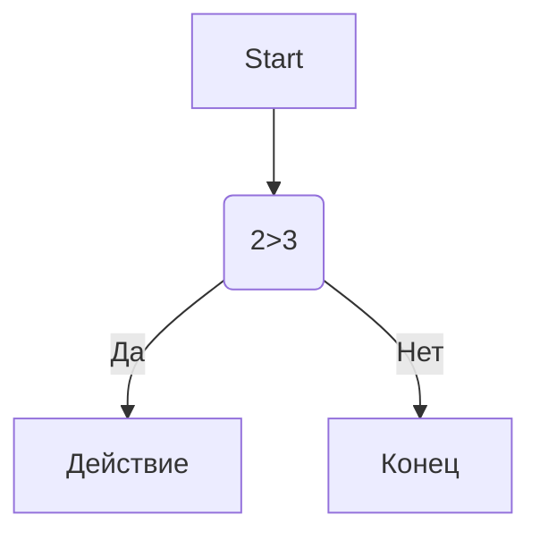

# 💻 Руководство по эффективной веб-разработке и автоматизации

В современной разработке важно не только писать чистый код, но и правильно документировать свои проекты. Данная статья объединяет лучшие практики по оформлению репозиториев и использованию встроенного инструментария.

---

## 📌 Основные этапы рабочего процесса

Для достижения максимального результата рекомендуется придерживаться следующего плана:

1. **Проектирование архитектуры**
   * Выбор технологического стека.
   * Определение структуры баз данных.
2. **Написание кода и автоматизация**
   * Использование скриптов на Python для рутинных задач.
   * Настройка интерактивных блок-схем.
3. **Финальное тестирование**
   * Проверка работы всех функций.
   * Оптимизация скорости загрузки.

Дополнительные задачи для самопроверки:
- [x] Написать базовый скрипт вычислений
- [ ] Оптимизировать вывод данных в консоль
- [ ] Настроить автоматический деплой

---

## 🛠 Примеры используемого программного кода

Ниже представлены рабочие примеры кода, которые мы используем в рамках автоматизации процессов нашего проекта.

### Исходный код на Python:
```python
c = a + b
print(f"{c} = {a} + {b}")
```

> **Важно помнить:**
> Правильное форматирование строк с помощью f-строк в Python существенно повышает *читаемость* и *скорость написания* вашего кода.
> > Постарайтесь всегда оставлять комментарии к сложной бизнес-логике.

---

## 📊 Структурированные данные и отчетность

Для наглядного мониторинга пользователей и их параметров используется следующая таблица:

| Name | Age | City |
| :--- | :---: | ---: |
| Ivan | 34 | MSK |
| Petr | 28 | SPB |
| Anna | 24 | NSK |

---

## 📐 Визуализация процессов и архитектуры

Для графического отображения логики работы нашего скрипта мы используем диаграммы формата **Mermaid**:



А вот как выглядит интерфейс нашей рабочей среды (ниже представлены **две фотографии**, демонстрирующие разные части конфигурационного файла):

### Часть 1. Основные настройки синтаксиса


### Часть 2. Специфические элементы и блоки данных


---

## 💡 Технические заметки и экранирование

При написании документации иногда требуется отобразить системные символы как обычный текст, не превращая их в элементы разметки. Для этого применяется экранирование с помощью обратного слэша `\`:

* Вывод обычного хештега вместо заголовка: \# fdf
* Вывод квадратных скобок в тексте: \[dsdssd\]

---

## 🔗 Полезные ресурсы и навигация

* [Официальный сайт проекта](https://example.com)
* [Перейти к разделу таблиц](#-структурированные-данные-и-отчетность)
